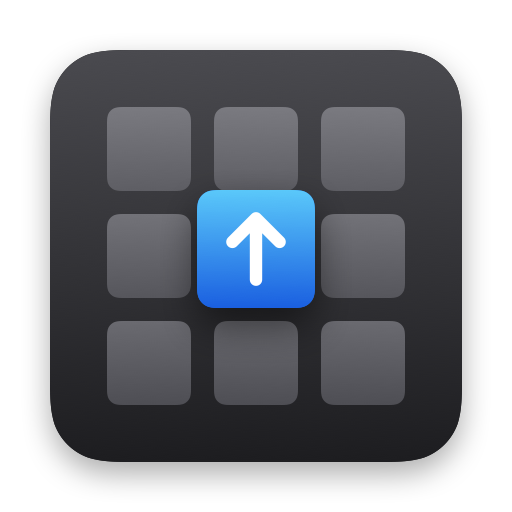
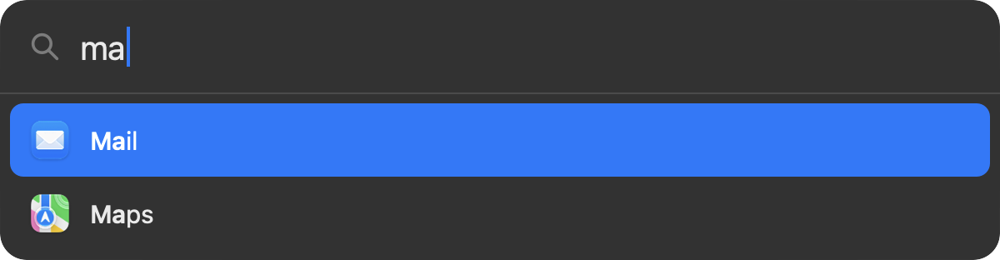
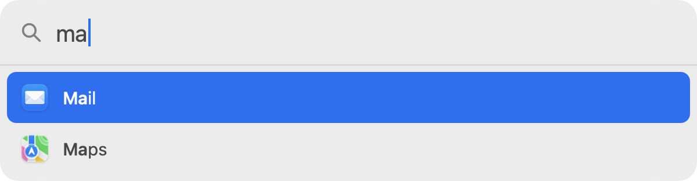
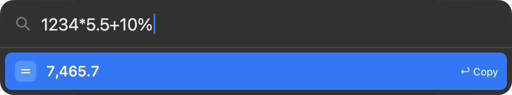
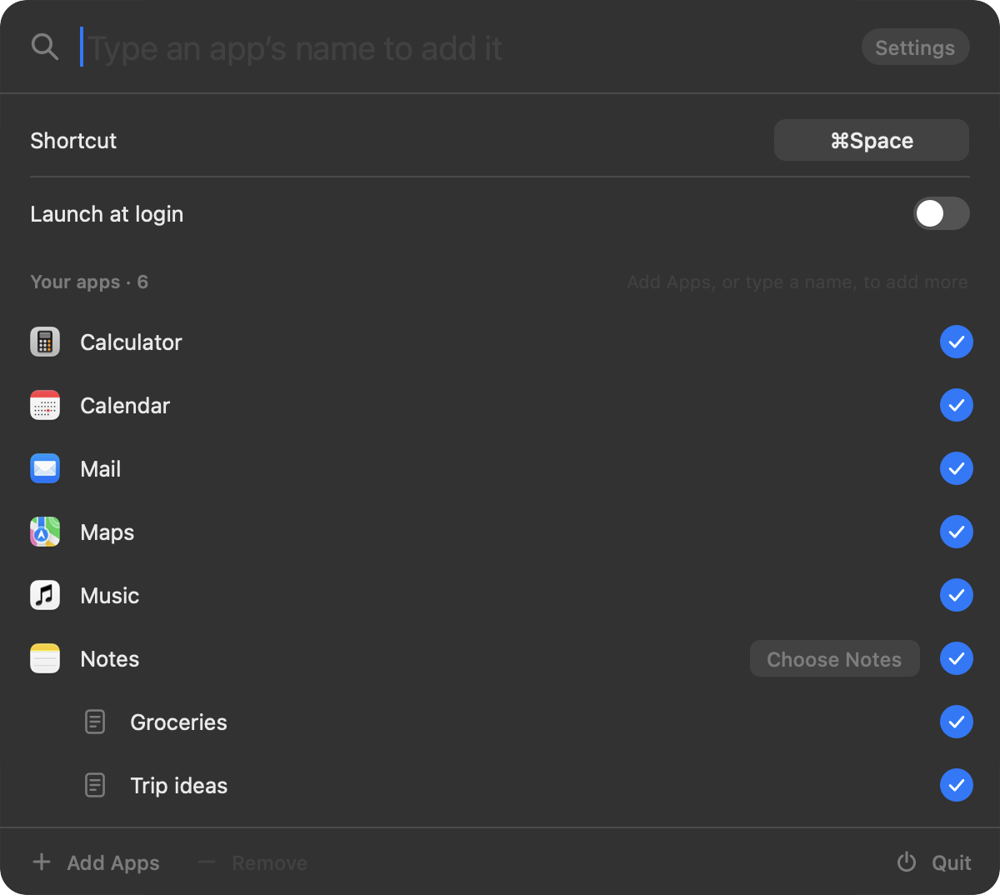
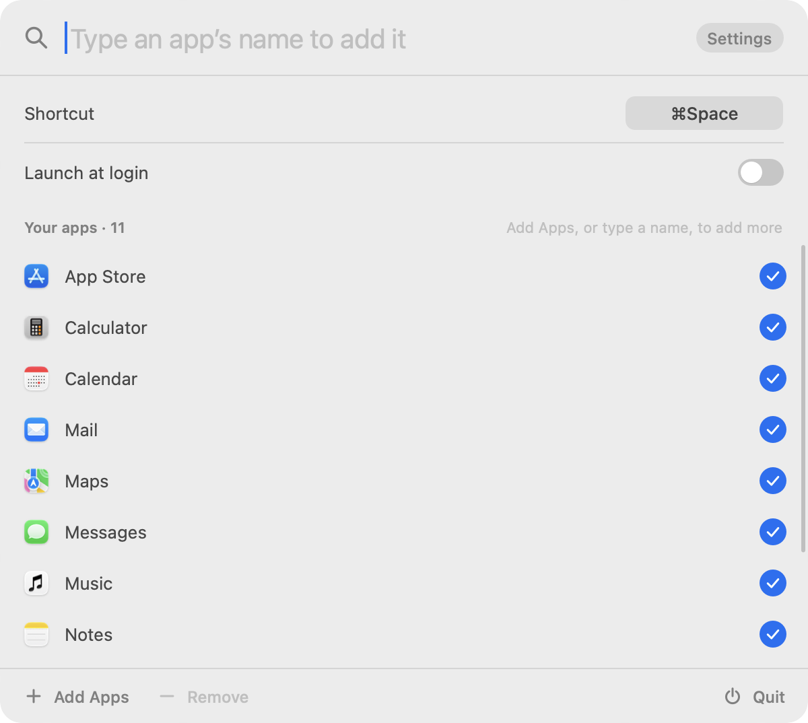

<p align="center"></p>

<h1 align="center">Launcher</h1>

<p align="center"><b>A small, fast app launcher for your Mac.</b><br>
Press <kbd>⌘</kbd><kbd>Space</kbd>, type a few letters, press <kbd>Return</kbd>. It looks only through the apps you
choose, and it does sums too.<br>
About 490 KB on disk and 9 MB of memory, with no CPU while idle.</p>

<p align="center">
  
  
</p>

## What it does

- **Only your apps.** Launcher searches the apps you add in its settings and nothing else: no files, no web
  results, no suggestions. The app you want is the one on top.
- **Instant.** The window appears the moment you press the shortcut, in the middle of your main display, and the
  app opens the moment you press <kbd>Return</kbd>. No animations, no waiting for results.
- **Type the starts of words.** `ma` finds Mail and Maps, `gc` finds Google Chrome, `vsc` finds Visual Studio
  Code. Launcher remembers which app you opened for which letters, so the same letters open the same app next time.
- **A calculator.** Type a sum and the answer appears as you type; <kbd>Return</kbd> copies it. See below.
- <kbd>↑</kbd> <kbd>↓</kbd> choose, <kbd>Return</kbd> opens, <kbd>Esc</kbd> closes, <kbd>⌘</kbd><kbd>,</kbd>
  opens the settings and <kbd>⌘</kbd><kbd>Q</kbd> quits.
- **The search line edits like any Mac text field.** <kbd>←</kbd> <kbd>→</kbd> move the caret, with
  <kbd>⌥</kbd> a word at a time; <kbd>⌘</kbd><kbd>←</kbd> <kbd>⌘</kbd><kbd>→</kbd> or <kbd>⌃</kbd><kbd>A</kbd>
  <kbd>⌃</kbd><kbd>E</kbd> go to either end; add <kbd>⇧</kbd> to select. <kbd>⌘</kbd><kbd>A</kbd>,
  <kbd>⌘</kbd><kbd>X</kbd> <kbd>⌘</kbd><kbd>C</kbd> <kbd>⌘</kbd><kbd>V</kbd>, <kbd>⌥</kbd><kbd>⌫</kbd>,
  <kbd>⌘</kbd><kbd>⌫</kbd>, <kbd>⌦</kbd>, <kbd>⌃</kbd><kbd>K</kbd> <kbd>⌃</kbd><kbd>D</kbd> <kbd>⌃</kbd><kbd>H</kbd>
  work too, and a click puts the caret where you click.

## Calculator

What macOS Calculator does, typed straight into the search line:

- `+ − × ÷` (or `* /`), brackets and the usual order of operations: `2+3*4` is 14, `(2+3)*4` is 20.
  `3x4`, `2pi` and `3(1+2)` multiply too.
- Powers and roots: `2^10`, `5²`, `10⁻¹`, `sqrt 2`, `√16`, `cbrt 27`, `root(27, 3)`.
- Percentages as on a calculator: `200+10%` is 220, `20% of 150` is 30.
- Logarithms: `ln 2`, `log 1000` (base 10), `log2(8)`, `log(81, 3)`, and `e^2` or `exp 2`.
- Trigonometry in degrees, as in Calculator: `sin 30`, `cos 60`, `tan 45`, `asin 1` (gives 90). Angles written
  with π are radians, `sin(π/6)`, and `rad` or `°` names the unit: `sin(1 rad)`. Also `sec`, `csc`, `cot`, `sinh`,
  `cosh`, `tanh` and their inverses.
- `5!` (and `2.5!`), `10 mod 3`, `abs`, `round`, `floor`, `ceil`, and the constants `π` and `e`.

The answer appears as you type, with your region's digit grouping; <kbd>Return</kbd> copies it as plain digits.

<p align="center">
  
</p>

## Settings

Press <kbd>⌘</kbd><kbd>,</kbd> while Launcher is open, or open Launcher from the Applications folder.

- **Add App…** opens the Applications folder: choose one app or several.
- **Remove** takes the selected app out of the list. It stays on screen, unchecked, until you close the
  settings, so one click puts it back.
- Or just type an app's name to find it among the installed apps, and press <kbd>Return</kbd> or click its circle
  to add it or remove it.

The settings also hold the shortcut and launch at login.

<p align="center">
  
  
</p>

On a new Mac <kbd>⌘</kbd><kbd>Space</kbd> belongs to Spotlight or the Apps view. When a macOS shortcut uses the
same keys, the settings say so: turn that shortcut off in System Settings › Keyboard › Keyboard Shortcuts, or pick
another shortcut for Launcher.

## Private by design

- Launcher never connects to the internet.
- It keeps its settings on your Mac: the list of apps, the shortcut, and which app you opened for which letters.
- No accounts, no telemetry, no ads. Launcher is free and open source under the MIT License.

## Install

Launcher runs on Macs with Apple silicon, on macOS 27 or later. Install it with Homebrew:

```sh
brew install bhaskar0210s/tap/launcher
```

Or without Homebrew, with one command in Terminal:

```sh
curl -fsSL https://raw.githubusercontent.com/bhaskar0210s/launcher/main/install.sh | sh
```

It downloads the latest release, checks it against the signature of Launcher's release key, installs it in
Applications and opens it. After a Homebrew install, open Launcher once from Applications. Either way, macOS opens
it without any warning.

**Or download it:** get `Launcher.dmg` from the [latest release](../../releases/latest), open it and drag Launcher
to Applications. macOS checks apps downloaded in a browser with Apple, and Launcher isn't notarized (that needs a
paid Apple developer account), so the first time you open it macOS says it can't verify that Launcher is free of
malware. Choose **Done**, then open System Settings → Privacy & Security and click **Open Anyway** next to
Launcher. You only need to do this once.

**Or build it yourself** with the Xcode command line tools (`xcode-select --install`):

```sh
git clone https://github.com/bhaskar0210s/launcher.git
cd launcher
make install    # builds Launcher.app, copies it to /Applications and starts it
```

The first launch from Applications adds Launcher to your login items and shows its settings, where you add your
apps. Launcher has no Dock icon and no menu bar icon: press the shortcut to use it, and press <kbd>⌘</kbd><kbd>,</kbd>
in it (or open the app again from Applications) for its settings.

To give Launcher <kbd>⌘</kbd><kbd>Space</kbd>, turn off the macOS shortcut that has it in System Settings →
Keyboard → Keyboard Shortcuts: "Show Spotlight search", or "Show Apps" where <kbd>⌘</kbd><kbd>Space</kbd> opens the
Apps view. Launcher's settings say which one has it, or you can pick another shortcut for Launcher there.

## How it stays small

- Swift and AppKit only: no SwiftUI, no web views, no other code. One optimized, stripped binary of about
  290 KB.
- No system text field. Launcher reads the keyboard itself (input methods still work), because a text field makes
  macOS start an AutoFill helper process of about 13 MB for the app.
- Everything is drawn on the CPU straight into the window's layer. AppKit's own drawing moves larger views onto
  the GPU, which loads a couple of megabytes of shaders for good.
- The window exists only while it is open, and the app icons are drawn once, at the size they are shown.

Measured on a MacBook Pro with M1 Pro and macOS 27.2, with ten apps added, using `footprint` (the memory figure
Activity Monitor shows) and `ps`:

| | |
|---|---|
| On disk | 492 KB (download: a 250 KB disk image) |
| Memory, 10 seconds after launch | 9.8 MB |
| Memory, after 10 idle minutes | 9.2 MB |
| Memory, during 30 minutes of opening, searching, calculating and settings every 2 seconds | about 15 MB, level from the fifth minute |
| Processor time in 10 idle minutes | 0.1 seconds |
| Opening the window | 0.5 ms (median of 50) |
| Searching, per key | 0.3 ms (median of 50) |

## Building and testing

```sh
make test       # unit tests for the calculator, the matching and the ranking (with sanitizers)
make harness    # build/LauncherTest.app: a copy driven by commands on standard input, for automated tests
make icon       # redraw the app icon (tools/icon.swift)
```
